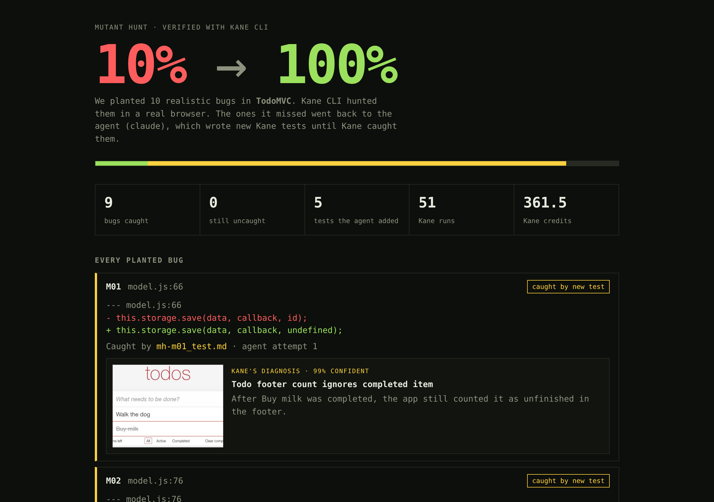

# Mutant Hunt

[](https://github.com/safwaankira/mutant-hunt/actions/workflows/ci.yml)

**Who tests your tests?** Mutant Hunt plants realistic bugs in your app, lets
[Kane CLI](https://www.testmuai.com/kane-cli/) hunt them in a real browser, and hands
every bug Kane misses back to your coding agent, which writes the Kane test that
catches it.

**▶ 30-second cut: https://youtu.be/jGEeS9W_b3M** · **3-minute demo: https://youtu.be/qCsWrZpO9sg** · **Live report: https://safwaankira.github.io/mutant-hunt/examples/todomvc/mutant-hunt-report/**



**Real run, TodoMVC, two starter Kane tests:** Claude Code planted 10 bugs. Kane caught **1**.
Every missed bug went back to Claude with Kane's report, Claude wrote 5 new Kane tests (two needed a
second try after Kane said "still passes"), and Kane then caught **all 9 real bugs**, each with its own
diagnosis, e.g. *"Todo edit field remains visible after saving: after Enter saves the changed todo, the page
does not leave editing mode"* (96% confident) for a flipped `iscanceled` check. The 10th change was
judged harmless, with the reason in the report. 51 Kane runs, 361 credits.
Full report: [`examples/todomvc/mutant-hunt-report`](examples/todomvc/mutant-hunt-report/index.html).
First public run: 17 Nov 2026 ([first commit `a000517`](https://github.com/safwaankira/mutant-hunt/commit/a000517)).

**Then we turned Kane's healing back on.** `mutant-hunt heal-check` re-ran all 9 caught bugs with
adaptive healing **on** (Kane's default). Healing hid **1 of 9**: M04, a store bug that un-completes a
todo after a delete. The pattern was clean: all 8 bugs caught by a failed **check** (`assertion_failed`)
stayed caught; the one caught only because a **replayed step broke** (`action_failed`) was healed away.
`heal-check --close` sent M04 back to Claude, which wrote `mh-m04-heal_test.md` on the first try.
With healing on, Kane now fails it and says *"Todo footer counts completed item as remaining"*.
**All 9 bugs are caught with healing on or off.** 176.9 credits for the healing run.

```bash
npm i -g @testmuai/kane-cli && kane-cli login --oauth
git clone https://github.com/safwaankira/mutant-hunt && cd mutant-hunt && npm i
cd examples/todomvc && node ../../bin/mutant-hunt.js run
```

## Why

Green end-to-end tests feel safe. They often aren't: a suite can click through every
screen and never check the number in the corner. Code coverage can't show that gap.
Mutation testing can (break the app on purpose and see whether a test notices), but until
now it only worked with unit tests. Mutant Hunt brings it to browser tests, and
then goes a step further: it fixes the gaps it finds.

## How it works

```
 your app ──► agent plants a bug ──► Kane runs your *_test.md in Chrome
                                        │
                     caught? ◄──────────┤
                        │               └─► missed ──► agent gets the diff + Kane's report
                        ▼                                │
                  kill score                             ▼
                                         agent writes a new Kane test
                                                         │
                         Kane: passes on the real app? ──┤──► no: Kane's failure goes back to the agent
                         Kane: fails on the bug?      ───┘──► no: "still passed" goes back to the agent
                                                         │
                                                  yes ──► caught, test kept
```

1. **Baseline.** Every Kane test must pass on the real app. Kane records each test the first time.
2. **Plant bugs.** The agent (Claude Code, Codex, or any OpenAI-compatible model) gets one source
   file at a time with one spot blanked out, and suggests a realistic wrong version: an
   off-by-one, the wrong filter, a flipped condition. Mutant Hunt keeps the ones that still parse.
3. **Hunt.** Each bug is served in turn and Kane replays your tests against it with
   **adaptive healing off** (`--no-adaptive-heal`). Healing would re-author a broken step and could
   work around the very bug we planted; with it off, a kill is Kane's evidence that the app broke.
4. **Close the loop.** Each bug Kane missed goes back to the agent with the diff and Kane's report.
   The agent writes a plain-English `*_test.md`. Kane must show it **passes on the real app** and
   **fails on the bug**. If either check fails, Kane's verdict and root cause go back to the agent for
   another try (up to 3). A new test is also replayed against the other bugs that are still uncaught.
5. **Report.** A kill score before and after, every bug with its diff, which test caught it, and
   **Kane's own diagnosis**: the failure title, root cause and screenshot that Kane's investigator seals
   into each run's evidence pack. `mutant-hunt-report/index.html` and `report.json`.

## Findings for the Kane team

From the real TodoMVC runs (hunt + healing check):

- **Healing can hide a regression.** A test that only fails because a replayed step can't find its
  element gets healed into a pass. A test that *checks* a value survives healing. Rule of thumb: every
  bug you care about needs a check, not just a click. `heal-check` finds the tests that rely on clicks.
- **Kane's RCA blamed the test in 4 of 9 real app bugs** (M02, M03, M06, M09: "test data" or
  "automation" category) even though the app was what we broke. The failure titles were still right.
- **The best diagnosis isn't in the `--agent` stream.** Title, root cause, confidence and screenshot
  live only in the sealed evidence pack, so `src/kane.js` unzips it (`readEvidence()`).
- **Replays emit almost no `run_end` summary**, so on a replay the evidence pack is the only record.
- **Exported Playwright code isn't always standalone.** We exported Claude's 6 tests with
  `kane-cli testmd export`. Without TestMu credentials, 2 of 6 still pass on the real app and fail on
  their bug. The other 4 use vision steps that return `null` offline. See
  [`examples/todomvc/playwright`](examples/todomvc/playwright/).

## Use it on your app

```bash
npx mutant-hunt init      # writes mutant-hunt.config.json and kane/smoke_test.md
npx mutant-hunt doctor    # Kane installed + signed in, agent CLI present
npx mutant-hunt run       # or: run --agent for NDJSON
npx mutant-hunt heal-check [--close]   # do your catches survive Kane's healing?
```

**Replay without an agent.** `run --replay` plants exactly the recorded bugs from
`.mutant-hunt/cache`, with no agent calls. You only need Kane:

```bash
cd examples/todomvc && node ../../bin/mutant-hunt.js run --replay
```

```json
{
  "describe": "what the app does, in one line, for the agent",
  "app": "public",
  "mutate": ["js/*.js"],
  "tests": "kane",
  "port": 4173,
  "maxMutants": 10,
  "agent": "claude"
}
```

`app` is served as static files; for an app with its own dev server add `"start": "npm run dev"`
(it gets `PORT`). `agent` is `claude`, `codex` or `openai` (`MH_LLM_ENDPOINT`, `MH_LLM_API_KEY`,
`MH_LLM_MODEL`). Every agent answer is cached in `.mutant-hunt/cache`, so a rerun plants the same bugs for free.

**From Claude Code:** copy `skills/mutant-hunt` into `~/.claude/skills/` and ask
"how good are my Kane tests?". Claude runs `mutant-hunt run --agent`, reads the NDJSON stream
(`mh_baseline`, `mh_mutant`, `mh_loop`, `mh_score`, `mh_done`) and reports the score. Exit code
`0` means every bug was caught, so it also works as a CI gate.

## For judges

| Criterion | Where to look |
|---|---|
| Ships | `examples/todomvc`: a real app, real Kane runs, three commands above. `run --replay` reproduces the recorded bugs with Kane alone. Each bug has a "Try this broken build" link in the live report |
| Verified | Each caught bug in the report has Kane's diagnosis (title, root cause, confidence) and its screenshot of the broken page, read from Kane's evidence pack (`readEvidence()` in `src/kane.js`). Healing is off for the hunt, then `heal-check` re-runs every catch with healing on (8/9 held, the 9th closed) |
| Closed loop | `src/hunt.js` `closeOne()`: Kane's verdicts and root causes go into the agent's next prompt; the loop ends only when Kane proves pass-on-real and fail-on-bug. In the recorded run, M02 and M07 each took a second attempt after Kane's feedback. `heal-check --close` runs the same loop with healing on (M04) |
| Craft | `npx`-style CLI, `doctor`, `--agent` NDJSON + exit codes, Claude Code skill, prompt cache, `npm test` (fake Kane + fake agent, runs offline), CI on Node 20 and 22 |

**What was reused, honestly.** The bug-planting prompts and site finder are adapted from
[LLMorpheus](https://github.com/neu-se/llmorpheus) (MIT, GitHub Next), see
`vendor/llmorpheus/NOTICE.md`. The demo app is [TodoMVC](https://github.com/tastejs/todomvc)'s
ES6 example (MIT), changed only to load without a bundler. Everything else (the Kane runner, the
hunt, the agent loop, the report, the skill) was written for the KaneCLI Online Hackathon, starting
from this repo's first commit.

## Limits

- Bugs are planted in JavaScript source. CSS and server code are not mutated yet.
- Kane runs cost credits: about 7 per Kane run (361 for the full hunt). Lower `maxMutants` for a first try.
- "Equivalent" bugs (no visible change) are judged by the agent, with its reason shown in the report.
  Check those yourself.

**Why AI-planted bugs, not hand-written ones?** Hand-written bug patches test the bugs you already
thought of. Mutant Hunt points an agent at any app's source and gets new bugs every run, then keeps
the same ones in the cache so scores stay comparable.

## Licence

MIT. LLMorpheus and TodoMVC keep their own MIT notices.
